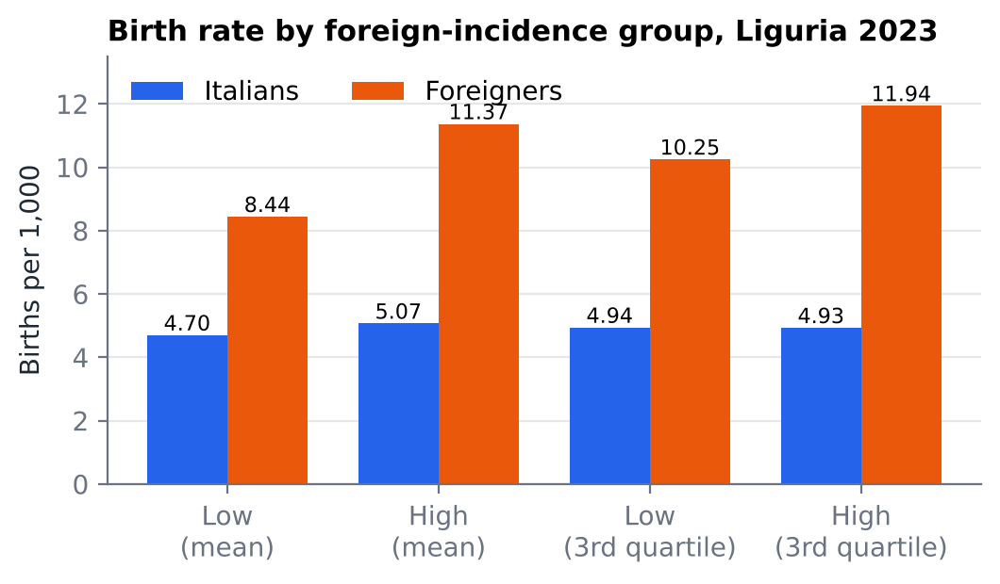
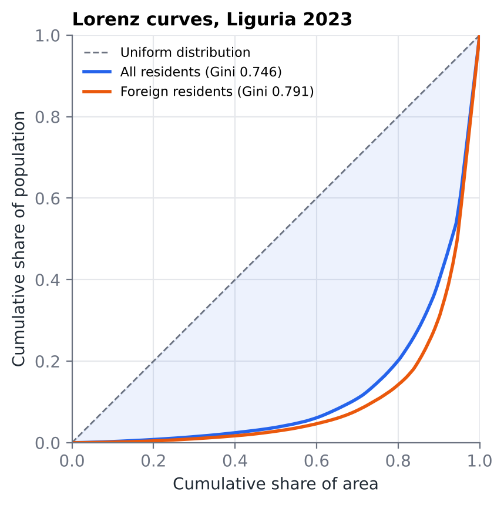

# Population, Territory and Society — Spatial Demography of Liguria

**Five applied exercises on ISTAT data · scale effects, concentration indices, location quotients, log-linear migration models, segregation indices · Python, R, SPSS, Excel**

📄 Each exercise has a full report in Italian; this page summarises them in English.

## Research question

How is the population of Liguria — and its foreign component in particular — distributed across the territory, and how does that distribution shape demographic indicators? Liguria is a useful case: mostly mountainous, with settlement crowded along the coast and in a few cities. Five exercises look at the question from different angles:

| # | Question | Folder |
|---|---|---|
| 1 | Do birth rates show a scale effect, and is Italian fertility different where more foreigners live? | [`01-birth-rates-and-foreign-population`](01-birth-rates-and-foreign-population) |
| 2 | How concentrated is the population relative to the area of municipalities? | [`02-territorial-concentration`](02-territorial-concentration) |
| 3 | Where do the main foreign communities settle, and did this change in 2019–2021? | [`03-location-quotients`](03-location-quotients) |
| 4 | Has the structure of residence transfers between Italian regions changed in ten years? | [`04-interregional-migration`](04-interregional-migration) |
| 5 | Are foreign upper-secondary students segregated across Liguria's provinces? | [`05-school-segregation`](05-school-segregation) |

## Data

All data come from **ISTAT**:

- demographic balance of the resident and foreign population by municipality, 2023 (demo.istat.it) — exercises 1–2;
- municipal land area and administrative boundaries — exercises 2–3;
- foreign residents by municipality and citizenship, 1 January 2019 and 2021 — exercise 3;
- residence transfers between regions, 2015 and 2025 — exercise 4;
- upper-secondary school enrolments by province, citizenship, gender and school type, a.y. 2022/23 — exercise 5.

Liguria has 234 municipalities in four provinces (Imperia, Savona, Genoa, La Spezia). Cleaned data and all calculations are in each exercise's `data/` folder; raw ISTAT downloads are not included.

## Methods

| # | Methods | Tools |
|---|---|---|
| 1 | Birth rates on mean population; population-weighted means and variances at municipal vs provincial level; high/low foreign-incidence groups using two thresholds (mean, third quartile) | Python, Excel |
| 2 | Municipalities ordered by density; Hoover index, Gini concentration ratio, Lorenz curves; check that Hoover = maximum gap between cumulative shares | SPSS, R, Excel |
| 3 | Location quotients on total and on foreign residents for communities covering 75% of foreigners; classification of change 2019–2021; municipal maps | Excel, QGIS-ready data |
| 4 | Origin–destination tables; multiplicative decomposition (total-sum reference coding); χ² tests of independence and quasi-independence | Excel |
| 5 | Dissimilarity, Gini, entropy, exposure and spatial proximity indices by school type and gender | Excel |

## Key results

**1. Scale changes variability, not the average.** Moving from municipalities to provinces leaves the weighted mean birth rate unchanged (5.53‰ overall, 10.75‰ for foreigners) while the variance falls about 23-fold. The Italian birth rate is practically the same in high- and low-incidence municipalities, whereas the foreign rate is about twice as high and rises where foreigners are more numerous.

<p align="center"></p>

**2. A strongly concentrated region.** About 60% of residents (Hoover index), and 66% of foreign residents, would have to move to obtain a uniform distribution over the territory; the Gini ratios are 0.746 and 0.791. Genoa alone holds 37% of residents and 41% of foreigners.

<p align="center"></p>

**3. Different communities, different geographies — but no school segregation.** Albanian, Romanian and Ukrainian residents are spread over 170+ municipalities, while 76% of Ecuadorians live in Genoa; Moroccans are over-represented (LQ ≥ 4) in the farming areas of the Albenga plain. Interregional mobility is stable over 2015–2025 (75.6% of moves stay within the region), and the segregation of foreign students between provinces is very low (index 0.027).

## How to reproduce

```bash
git clone https://github.com/SofiaMenegozzo/Population-Territory-and-Society.git
cd Population-Territory-and-Society
```

- **Exercise 1:** download the 2023 demographic balances (total and foreign population, by municipality) from demo.istat.it as `p2.csv` and `p3.csv`, then run `python data_cleaning.py` to keep the Ligurian municipalities and the variables used.
- **Exercise 2:** open R in `02-territorial-concentration/` and run `lorenz_curves.R` (packages `readxl`, `ggplot2`); the SPSS `.sav` files in `data/spss/` contain the intermediate calculations.
- **Exercises 3–5:** open the workbook in each `data/` folder; every index is computed with formulas on the cleaned data.

## Also in this repository

📁 [`greaves-climate-change-and-optimum-population`](greaves-climate-change-and-optimum-population) — slides and written summary (Italian) of a class presentation on Hilary Greaves (2019), *Climate Change and Optimum Population*, *The Monist*. Its central point: warming depends on cumulative emissions rather than on the emission rate, so a smaller population helps the climate only for subtler and less conclusive reasons than is often assumed.

## Repository structure

```
01-birth-rates-and-foreign-population/   report_E1.pdf · data_cleaning.py
02-territorial-concentration/            report_E2.pdf · lorenz_curves.R · data/ (Excel + SPSS)
03-location-quotients/                   report_E3.pdf · data/
04-interregional-migration/              report_E4.pdf · data/
05-school-segregation/                   report_E5.pdf · data/
greaves-climate-change-and-optimum-population/   slides.pptx · summary.pdf
figures/                                 charts used in this README
```

**Authors:** Sofia Menegozzo, Alessia Cazzulani — *Popolazione, Territorio e Società 1*, BSc Statistics and Information Management, University of Milano-Bicocca, a.y. 2026–27
